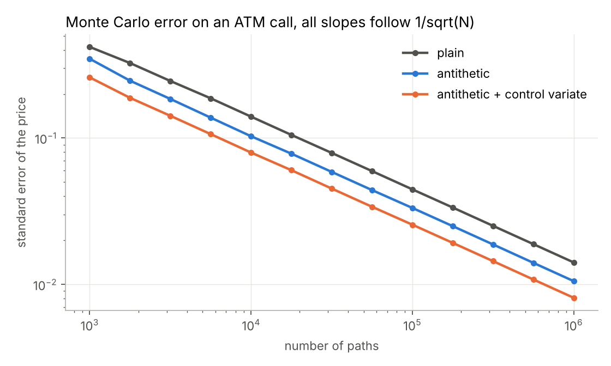
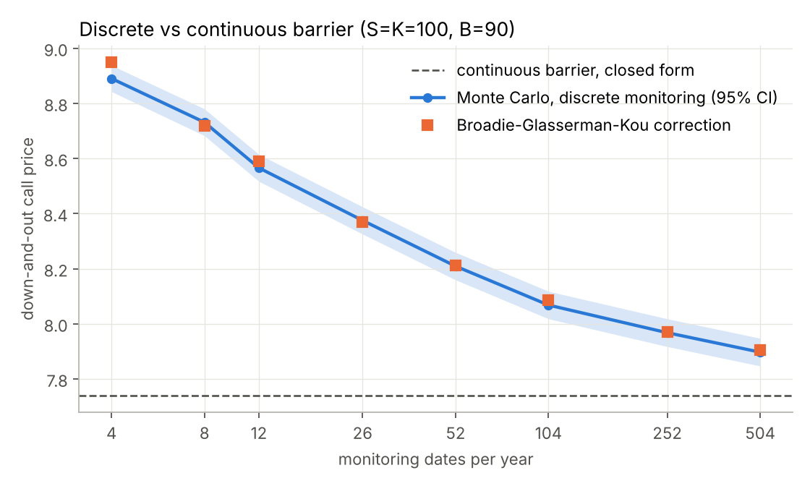
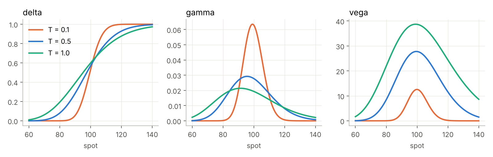

# pricer

[](https://github.com/adrienliao/option-pricing-engine/actions/workflows/tests.yml)


A small option pricing library in Python, written to understand the numerics properly rather than call a black box. Every Monte Carlo estimate comes with its standard error, and every numerical method is tested against a closed form.

| Module | What it does |
| --- | --- |
| `black_scholes` | Vectorised BSM prices and Greeks (delta, gamma, vega, theta, rho) with dividend yield |
| `implied_vol` | Newton-Raphson with a Brent fallback when vega gets too small, plus no-arbitrage checks |
| `binomial` | Cox-Ross-Rubinstein tree, European and American exercise, early exercise premium |
| `monte_carlo` | GBM paths, antithetic variates, control variate, pathwise delta, down-and-out barriers with a Brownian bridge |
| `barrier` | Closed form down-and-out / down-and-in calls (Reiner-Rubinstein) and the Broadie-Glasserman-Kou continuity correction |

## A few results

**Variance reduction.** On an ATM call, antithetic draws combined with the discounted terminal spot as a control variate cut the variance by about 3x, which is the same as running three times as many paths for free. The slope stays at 1/sqrt(N), as it should.



**Discrete vs continuous barriers.** A barrier checked once a day is not the same product as a continuously monitored one: with daily monitoring the down-and-out call is still about 3% more expensive than the closed form. The Broadie-Glasserman-Kou trick (shift the barrier by `exp(-0.5826 sigma sqrt(dt))`) lands right inside the Monte Carlo confidence band at every frequency. For the continuous case, weighting each path by its Brownian bridge survival probability removes the bias without needing thousands of time steps.



**Greeks.** Gamma and vega concentrate around the strike as maturity shrinks.



## Usage

```bash
pip install -e ".[dev]"
pytest -q                     # 85 tests, about 3 seconds
python examples/make_figures.py
```

From Python:

```python
from pricer import black_scholes as bs, monte_carlo as mc, binomial, barrier, implied_vol

bs.greeks("call", S=100, K=105, T=0.5, r=0.03, sigma=0.2)
implied_vol(4.20, "call", S=100, K=105, T=0.5, r=0.03)
binomial.crr_price("put", 100, 105, 1.0, 0.05, 0.2, steps=1000, american=True)

res = mc.down_and_out("call", 100, 100, 1.0, 0.03, 0.2, B=90, n_steps=252, continuous=True)
print(res.price, res.ci())
```

Or from the command line:

```bash
python -m pricer bs --kind put --K 110
python -m pricer barrier --B 90 --paths 200000
python -m pricer iv --price 10
```

## How it is tested

The tests check the maths, not just that the code runs:

* put-call parity across strikes, and Hull's textbook values
* every analytic Greek against a central finite difference
* no butterfly arbitrage: call prices decreasing and convex in strike
* implied vol round trips over strikes from 50 to 200, maturities from a week to 3 years and vols from 5% to 120%
* CRR converging to Black-Scholes, American call without dividends equal to the European, positive early exercise premium for puts
* Monte Carlo prices within 4 standard errors of the closed form, for vanillas, pathwise delta and barriers (both sides of the strike)
* discretely monitored barriers matching the BGK corrected closed form

## Performance

Everything is vectorised with numpy. On a laptop, a 2000 step American CRR tree takes about 60 ms and a million path European Monte Carlo with variance reduction about 50 ms.

## What I would add next

Heston with a QE scheme and calibration to a real vol surface, Longstaff-Schwartz for American options by Monte Carlo, and Sobol sequences to compare quasi Monte Carlo convergence.

## References

* J. Hull, *Options, Futures and Other Derivatives*
* P. Glasserman, *Monte Carlo Methods in Financial Engineering*
* M. Broadie, P. Glasserman, S. Kou (1997), *A continuity correction for discrete barrier options*
